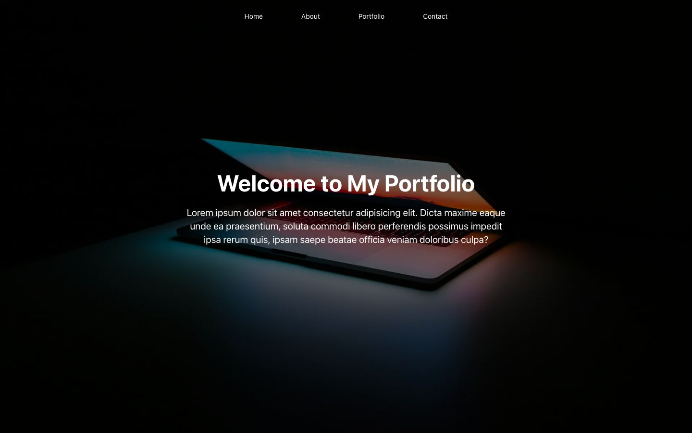

# Portfolio Website

A single-page portfolio template I built for practice with Next.js 16, React 19, TypeScript, Tailwind CSS 4 and shadcn/ui. It has four sections: hero, about, project cards and a contact form. All text is placeholder (lorem ipsum), so it is meant to be cloned and filled in, not used as-is.

## Screenshots




## Run locally

Needs Node.js 20.9+ and pnpm.

```bash
git clone https://github.com/replikduplik/portfolio-website.git
cd portfolio-website
pnpm install
pnpm dev
```

Open http://localhost:3000.

## Structure

```
src/app/            layout, page, global styles
src/components/     navbar, about, portfolio, contact
src/components/ui/  shadcn/ui components
public/images/      background image
```

## Customize

- Text: edit the components in `src/components/` and `src/app/page.tsx`.
- Projects: edit the `projects` array in `src/components/portfolio.tsx`.
- Contact form: replace `you@example.com` in `src/components/contact.tsx`.
- Background: replace `public/images/background.jpg`.
