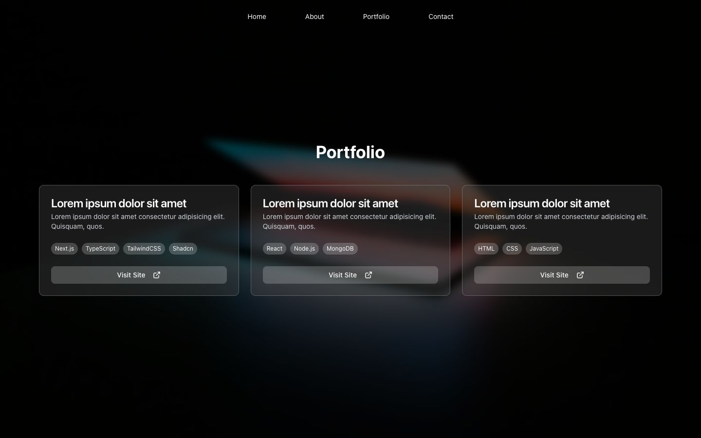
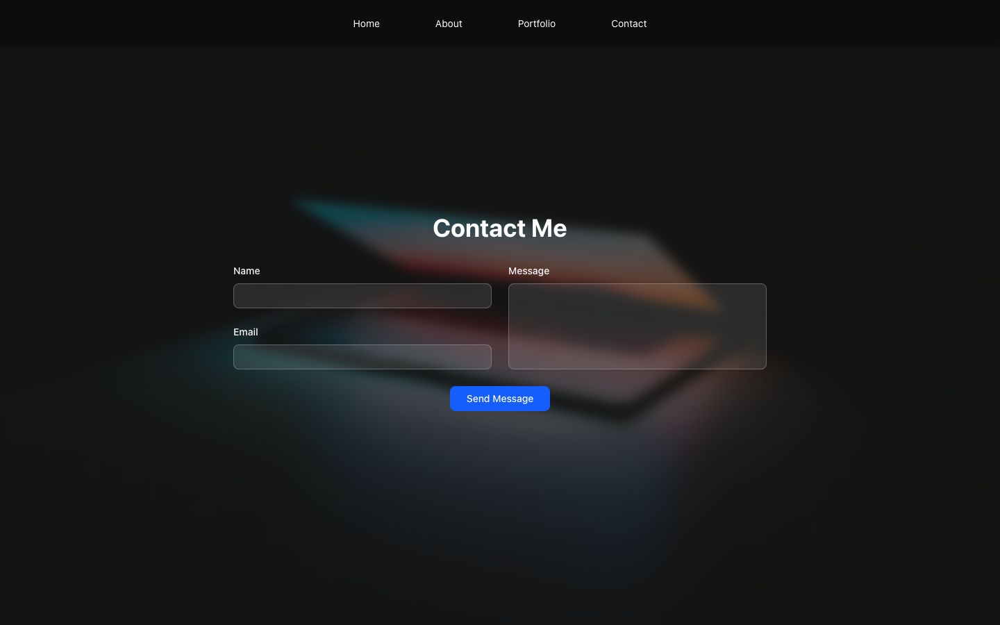

# Portfolio Website Template

A single-page portfolio starter built with Next.js, Tailwind CSS and shadcn/ui. Clone it, replace the placeholder text and projects, and deploy.


## What you get

- **Four sections:** hero, about, project cards and a contact form, linked from a sticky navbar.
- **Responsive layout:** project cards go from one to three columns; the navbar fits on phone widths.
- **Static output:** the page is prerendered at build time, so it runs on any host that supports Next.js.
- **Optimized background:** the full-screen image is served through `next/image` in a size that fits the device.

| Project cards | Contact form |
| --- | --- |
|  |  |

## Tech stack

- [Next.js 16](https://nextjs.org/) (App Router) and [React 19](https://react.dev/)
- [TypeScript](https://www.typescriptlang.org/)
- [Tailwind CSS 4](https://tailwindcss.com/)
- [shadcn/ui](https://ui.shadcn.com/) components and [Lucide](https://lucide.dev/) icons

## Getting started

Needs Node.js 20.9+ and pnpm.

Click **Use this template** on GitHub to create your own copy, or clone this repo directly:

```bash
git clone https://github.com/replikduplik/portfolio-website.git my-portfolio
cd my-portfolio
pnpm install
pnpm dev
```

Open http://localhost:3000.

| Command | What it does |
| --- | --- |
| `pnpm dev` | Start the dev server |
| `pnpm build` | Build for production |
| `pnpm start` | Serve the production build |
| `pnpm lint` | Run ESLint |

## Make it yours

| What | Where |
| --- | --- |
| Hero text | `src/app/page.tsx` |
| About text | `src/components/about.tsx` |
| Projects | the `projects` array in `src/components/portfolio.tsx` |
| Contact address | `you@example.com` in `src/components/contact.tsx` |
| Background image | `public/images/background.jpg` |
| Page title and description | `metadata` in `src/app/layout.tsx` |

The contact form uses a `mailto:` link, which opens the visitor's mail app. For real delivery, point the form's `action` at a form service instead.

## Project structure

```
src/app/            layout, page, global styles
src/components/     navbar, about, portfolio, contact
src/components/ui/  shadcn/ui components
public/images/      background image
docs/screenshots/   images used in this README
```
